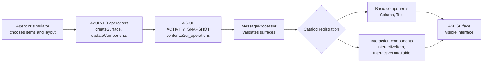
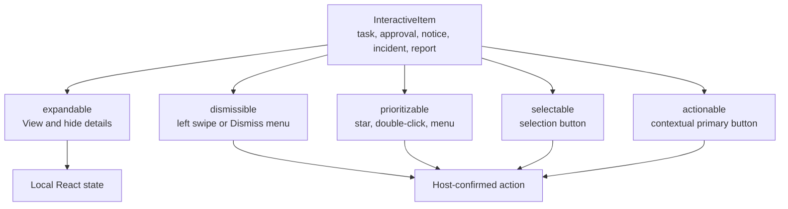
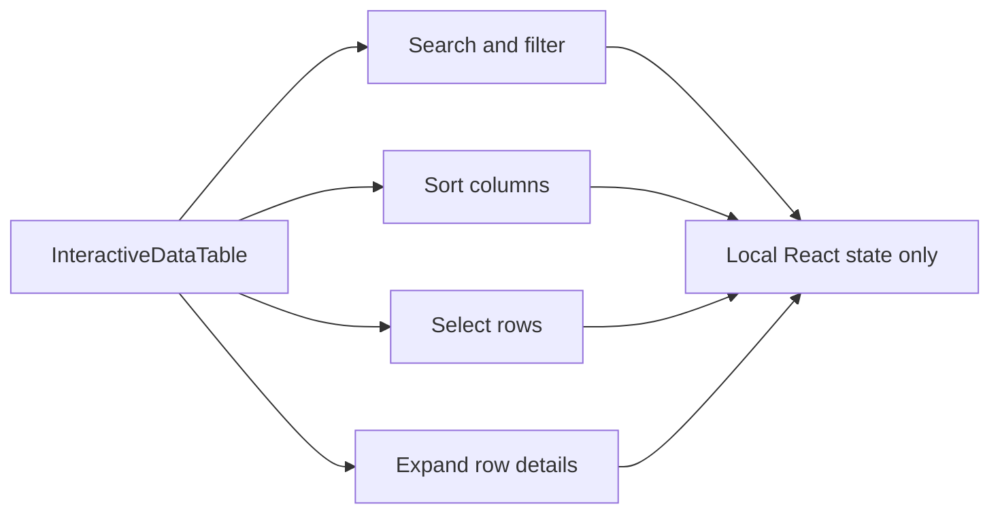
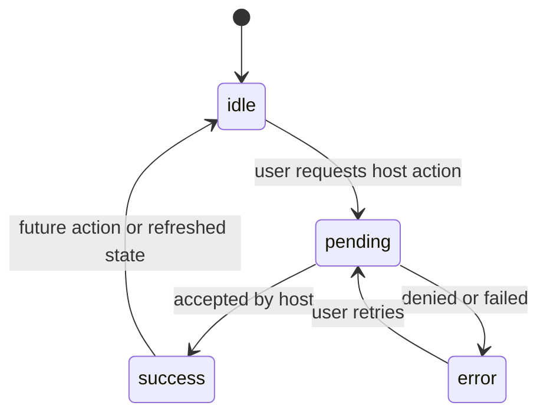
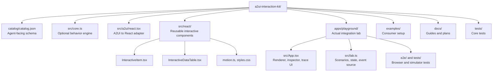
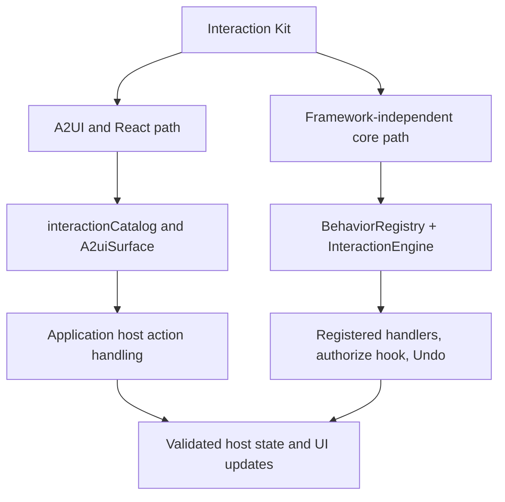
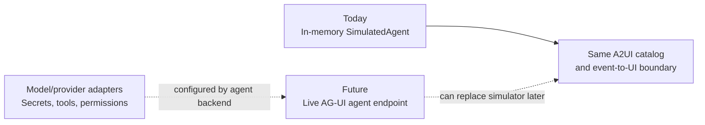

# Architecture: A2UI Interaction Kit

> Visual guide to the repository's current implementation, verified against `src/`, `catalog/`, and `apps/playground/` on `main` (November 2026). Mermaid diagrams render directly on GitHub.

**Purpose:** An agent or simulator describes a UI using A2UI. The renderer constructs reusable components. The Interaction Kit supplies controls, gestures, and feedback. The host application verifies and executes meaningful actions, then sends updated UI state.

**Contents:** [System architecture](#1-system-architecture) · [Rendering](#2-how-agent-output-becomes-ui) · [Available interactions](#3-available-interactions) · [Action lifecycle](#4-a-user-action-from-gesture-to-rendered-result) · [State and motion](#5-state-feedback-and-animation) · [Repository layout](#6-repository-layout) · [Core engine and extension](#7-optional-core-engine-and-extensibility) · [Future AG-UI](#8-current-vs-future-agent-integration)

## 1. System architecture

```mermaid
flowchart TB
  subgraph PRODUCER["Agent output"]
    SIM["SimulatedAgent<br/>Current Lab: in-memory"]
    LIVE["Real AI agent<br/>Future integration"]
  end
  subgraph WIRE["Protocol and renderer"]
    EVT["AG-UI-shaped events<br/>A2UI operations inside ACTIVITY_SNAPSHOT"]
    APP["Lab App.tsx<br/>event bridge and action callback"]
    PROC["A2UI MessageProcessor<br/>Basic Catalog + Interaction Catalog"]
    SURFACE["React A2uiSurface"]
  end
  subgraph KIT["Reusable Interaction Kit"]
    SCHEMA["catalog/catalog.json<br/>agent-facing component contract"]
    ADAPT["src/a2ui/react.tsx<br/>component schema and registration"]
    ITEM["InteractiveItem<br/>cards, gestures, actions"]
    TABLE["InteractiveDataTable<br/>local table exploration"]
    MOTION["motion.ts and styles.css<br/>transitions and feedback"]
  end
  HOST["Simulated host state<br/>apps/playground/src/lab.ts"]
  USER["User"]
  SCHEMA -. "controls allowed UI" .-> SIM
  SCHEMA -. "same contract later" .-> LIVE
  SIM --> EVT
  LIVE -. "future network AG-UI integration" .-> EVT
  EVT --> APP --> PROC --> SURFACE
  ADAPT --> PROC
  SURFACE --> ITEM
  SURFACE --> TABLE
  MOTION -. enhances .-> ITEM
  MOTION -. enhances .-> TABLE
  USER --> ITEM
  USER --> TABLE
  ITEM -->|"A2UI ActionPayload"| PROC
  PROC -->|"onAction callback"| APP
  APP -->|"submitAction"| HOST
  HOST -->|"updated AG-UI events"| EVT
  classDef planned stroke-dasharray:5 5;
  class LIVE planned;
```



**Solid arrows describe code that runs today.** `SimulatedAgent` publishes AG-UI event *objects* into the React app. The Lab does **not** use a live model, a remote AG-UI transport, or real MCP tool execution. The dashed branch is a planned integration, not an implemented network layer.

The separate framework-independent `InteractionEngine` is available for application hosts, but the Lab's main action path goes directly to `SimulatedAgent.submitAction`.

## 2. How agent output becomes UI



The host registers `new MessageProcessor([basicCatalog, interactionCatalog], onAction)`. The Basic Catalog provides layout and text; `src/a2ui/react.tsx` registers the reusable components from our Interaction Catalog. The simulator's custom A2UI components include the matching `catalogId`.

The schema in `catalog/catalog.json` tells an agent which components and properties it may generate. It supplies **declarative UI constraints**, not executable code. The rendered controls appear when the component has both the relevant capability and a callback.

## 3. Available interactions



| Semantic capability | User input | Action and owner |
| --- | --- | --- |
| `expandable` | View details / Hide details | Locally toggles card details |
| `dismissible` | Touch swipe left, or Dismiss in action menu | Host `dismiss_item` |
| `prioritizable` | Star, double-click empty card area, or menu | Host `prioritize_item` |
| `selectable` | Selection icon | Host `select_item` |
| `actionable` | Contextual primary button, such as Review | Host `activate_item` |

The **card variant** controls the card's appearance and wording. Its **capabilities** control which behavior is enabled. They are independent.



The table receives A2UI-defined `columns` and `rows`. Its current search, sorting, multi-selection, and row detail expansion are local. **They do not persist data or send host mutations.**

## 4. A user action from gesture to rendered result

A dismiss action demonstrates the actual two-way loop in the current Lab:

```mermaid
sequenceDiagram
  autonumber
  actor User
  participant Card as InteractiveItem
  participant Processor as A2UI MessageProcessor
  participant App as Lab App
  participant Host as SimulatedAgent
  participant Surface as A2uiSurface

  User->>Card: Swipe left or choose Dismiss
  Card->>Card: Preview gesture motion
  Card->>Processor: onDismiss ActionPayload
  Processor->>App: onAction callback
  App->>Host: submitAction(payload)
  Host->>Host: Validate item, surface, capability, busy state
  Host-->>App: ACTIVITY_SNAPSHOT with pending A2UI update
  App->>Processor: processMessages(updateComponents)
  Processor-->>Surface: Pending feedback; controls disabled
  Host->>Host: Check simulated permission and outcome
  alt Host accepts
    Host->>Host: Mark item dismissed
    Host-->>App: Activity and state snapshots
    App->>Processor: Apply updated components
    Processor-->>Surface: Card disappears; Undo available
  else Host rejects
    Host-->>App: Error update plus RUN_ERROR
    App->>Processor: Apply error feedback
    Processor-->>Surface: Item remains visible and retryable
  end
```

The item disappears only **after host acceptance**. In the Lab, dismiss sets `dismissed = true` in simulated state and filters the visible collection. Undo calls `SimulatedAgent.undoLast()`, which may also be denied.

The built-in core engine names its generic actions `dismiss`, `prioritize`, `select`, and `activate`. The Lab uses `dismiss_item`, `prioritize_item`, `select_item`, and `activate_item`; applications own the mapping between action payloads and handlers.

## 5. State, feedback, and animation



`InteractiveItem` supports `feedbackPhase` (`idle`, `pending`, `success`, `error`) and `feedbackMessage`. These values must come from **host-owned state**. A swipe or button callback alone never confirms persistence.

The kit includes swipe-follow and snapback, detail/priority/entrance animations, keyboard-accessible action menus, and a reduced-motion fallback. In the Lab, `withInteractionTransition(update)` wraps the synchronous A2UI processor update, with a normal update when browser View Transitions are unsupported, reduced motion is requested, or another transition is active.

## 6. Repository layout



| File | What it owns |
| --- | --- |
| `catalog/catalog.json` | Agent-visible schema, allowed properties, and component instructions |
| `src/a2ui/react.tsx` | Zod schemas and registration of `InteractiveItem` / `InteractiveDataTable` |
| `src/react/InteractiveItem.tsx` | Accessible card controls, gestures, local expand state, feedback |
| `src/react/InteractiveDataTable.tsx` | Read-only local search, sort, row selection, and details |
| `src/react/motion.ts` / `styles.css` | Progressive transitions, animations, and fallback styling |
| `src/core.ts` | Standalone `BehaviorRegistry`, `InteractionEngine`, authorization hook, handler dispatch, optional undo stack |
| `apps/playground/src/lab.ts` | Nine deterministic scenarios, in-memory host, simulated AG-UI events, pending/accept/reject outcomes |
| `apps/playground/src/App.tsx` | A2UI processor, surface renderer, action callback, inspector, recording and replay |
| `examples/` | A2UI setup and React integration examples |
| `docs/LAB.md` | Run and test the Lab |
| `docs/INTERACTION_LAB_PLAN.md` | Original phased implementation plan |

## 7. Optional core engine and extensibility



There are **two reusable integration paths**. The A2UI/React path renders agent-described interfaces. The optional core engine validates registered behavior/action pairs, performs handler dispatch, limits duplicate in-flight requests, supports an authorization callback, and keeps an in-memory Undo stack for operations whose handlers return real compensating functions. The Lab currently demonstrates the former with its own simulated host.

To add `snoozable` (example), implement the behavior contract in the core registry if used, extend `catalog/catalog.json` and `src/a2ui/react.tsx`, add its accessible UI action/gesture in React, implement a host handler that checks permissions, and cover pending/success/failure/undo in browser tests. **Registering a core behavior alone does not add an A2UI component or gesture.**

## 8. Current vs. future agent integration



The Lab demonstrates **Mission Control, Approval Queue, Error & Recovery, Permission Denied, Streaming Updates, Multiple Surfaces, Stress Test, Notification Inbox, and Review Board**. It supports latency and permission/error simulation, event inspection, and JSON recording/replay. It does **not** currently execute real MCP tools or connect to a live model/provider.

The planned live integration should use a real AG-UI-compatible agent endpoint and keep the backend responsible for model selection, secrets, action authorization, and durable state.

---

**Related:** [Interaction Lab operations](LAB.md) · [Original implementation plan](INTERACTION_LAB_PLAN.md) · [Live playground](https://danejw.github.io/a2ui-interaction-kit/).
